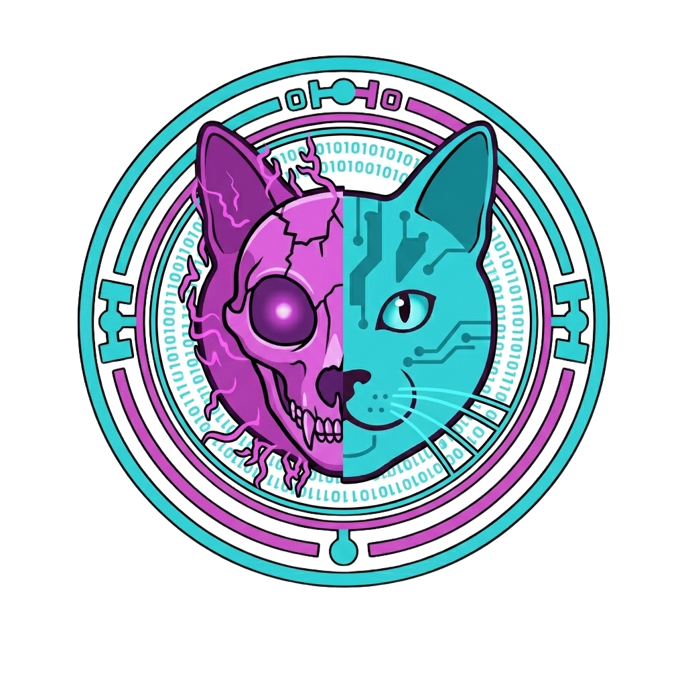

# Qiskit Fall Fest 2026 - Wits QCIG



## Welcome
This is the [Qiskit Fall Fest](https://qiskit.org/events/fall-fest/) event for the University of the Witwatersrand (Wits). We're so excited to have you all here. This event is being hosted by the **Quantum Computing Interest Group (QCIG)** at Wits.

Qiskit Fall Fest brings quantum computing events to university campuses worldwide. Each event is planned and run by students at that campus, backed by the IBM Quantum team. Student organizers collaborate with IBM in the lead-up to design their event, which then takes place over the following months. Formats range from technical hackathons to challenges aimed at newcomers, all built around growing quantum computing skills within the local community.

The Fall Fest here at Wits is a three-day series of workshops, talks and quizzes. Details about the event can be found below. Good luck!

--------------------------------
## Event Details
- **Dates:** 23 to 25 November 2026
- **Venue:** MSL004 & MSL005, T. W. Kambule Mathematical Sciences Building, Wits University
- **Times:** Day 1, 10:00 – 16:00 · Days 2 and 3, 08:30 – 14:30
- **What you need:** a Google account. Lab computers are provided, and the hands-on sessions run in [Google Colab](https://colab.research.google.com/) in your browser, so there is nothing to install.
- **Full rules and information:** https://qiskit-fall-fest-five.vercel.app/

--------------------------------
## Schedule
Celebrate learning Quantum Computing and Qiskit this Fall Fest, across three days: **Day 1: Foundations**, **Day 2: Applications** and **Day 3: Frontiers**.

<b>Day 1 — Foundations</b> *Monday 23 November 2026*

| Time | Session | Location |
|------|---------|----------|
| 10:00 – 10:20 | **Arrival & Sign-In** — Settle in, sign the register, and grab a coffee before we begin | Foyer |
| 10:20 – 10:45 | **Welcome & Icebreaker Quiz** — Introductions, agenda at a glance and an icebreaker quiz to set the tone | Laboratory |
| 10:45 – 11:15 | **Crash Course: What is Quantum Computing?** — A beginner-friendly overview covering history, key concepts, and real-world applications | Laboratory |
| 11:15 – 11:45 | **Comprehensive Overview of Quantum Computing Fundamentals** — Deep dive into the building blocks of quantum computing: qubits, superposition and entanglement | Laboratory |
| 11:45 – 11:55 | **Break** — Refreshments and networking | Foyer |
| 11:55 – 12:10 | **Quiz: Quantum Fundamentals** — Put your quantum knowledge to the test | Laboratory |
| 12:10 – 12:45 | **IBM Quantum Circuit Composer** — What is the IBM Quantum Circuit Composer and how to use it (a live demo) | Laboratory |
| 12:45 – 13:45 | **Keynote: Quantum Computing in Practice** — Where quantum computing stands, and where it's headed | Laboratory |
| 13:45 – 14:30 | **Lunch** — Refreshments and networking | Foyer |
| 14:30 – 15:30 | **Workshop: Build a Variational Quantum Algorithm** — Build and run a simple VQA on a quantum simulator in Google Colab | Laboratory |
| 15:30 – 16:00 | **Concluding Remarks and Q&A** — Day 1 reflections, followed by an open Q&A | Laboratory |

<b>Day 2 — Applications</b> *Tuesday 24 November 2026*

| Time | Session | Location |
|------|---------|----------|
| 08:30 – 08:50 | **Arrive and Find Your Footing** — Welcome back. Grab a coffee and get ready for Day 2 | Foyer |
| 08:50 – 09:10 | **Recap Quiz** — Refresher quiz: everything we've covered so far | Laboratory |
| 09:10 – 10:15 | **Random Number Generation Circuits** — Where true randomness is born: quantum circuits | Laboratory |
| 10:15 – 10:30 | **Break** — Refreshments and networking | Foyer |
| 10:30 – 11:30 | **Workshop: Optimisation** — Lab and tutorial on the Travelling Salesman Problem | Laboratory |
| 11:30 – 11:45 | **Consolidation Quiz: Bringing It All Together** — Test how far you've come over the duration of the workshop | Laboratory |
| 11:45 – 12:45 | **Keynote: Future and Careers in Quantum Computing** — Hear from industry professionals on where quantum computing is headed and how to build a career in this emerging field | Laboratory |
| 12:45 – 13:00 | **Break** — Refreshments and networking | Foyer |
| 13:00 – 14:00 | **Workshop: Quantum Machine Learning** — Lab and tutorial on machine learning applications | Laboratory |
| 14:00 – 14:30 | **Concluding Remarks and Q&A** — Day 2 reflections, followed by an open Q&A | Laboratory |

<b>Day 3 — Frontiers</b> *Wednesday 25 November 2026*

| Time | Session | Location |
|------|---------|----------|
| 08:30 – 08:50 | **Arrival & Sign-In** — Final day! Grab a coffee and get ready | Foyer |
| 09:10 – 10:15 | **Frontier Research Session** — *TBC* | Laboratory |
| 10:15 – 10:30 | **Quiz** — *TBC* | Laboratory |
| 10:30 – 11:30 | **Frontier Research Session** — *TBC* | Laboratory |
| 11:30 – 11:45 | **Quiz** — *TBC* | Laboratory |
| 11:45 – 12:45 | **Frontier Research Session** — *TBC* | Laboratory |
| 12:45 – 14:00 | **Prize Giving, Certificates & Closing** — Awards for our top quiz scorers and circuit builders, followed by certificate presentation & closing remarks | Laboratory |

--------------------------------
### Challenge Winners
1. *TBD*
2. *TBD*
3. *TBD*

--------------------------------

### Where to next?
To continue on your journey of exploring quantum computing, see
- IBM Quantum Learning (free courses): https://quantum.cloud.ibm.com/learning

--------------------------------

## Repository Structure

```
├── Day 1/                         # Day 1 (Foundations) sessions and workshop materials
├── Day 2/                         # Day 2 (Applications) sessions and workshop materials
├── Day 3/                         # Day 3 (Frontiers) sessions and materials
├── QFF_Materials/                 # General Qiskit Fall Fest materials
├── QCIG-Logo.png                  # QCIG logo
└── README.md                      # You are here
```

During the event, the workshop notebooks run in Google Colab: open the notebook from the folder for that day, then upload it at https://colab.research.google.com/ (**File → Upload notebook**).

To run a notebook on your own computer instead, you need Python 3.10 or newer; the first cell of each notebook installs the packages it needs.

--------------------------------

## Contact
Questions about the event? Reach out to Shawal or the QCIG organizing team.

<br><br>
[Qiskit Events Code of Conduct](https://github.com/Qiskit/qiskit/blob/master/CODE_OF_CONDUCT.md)